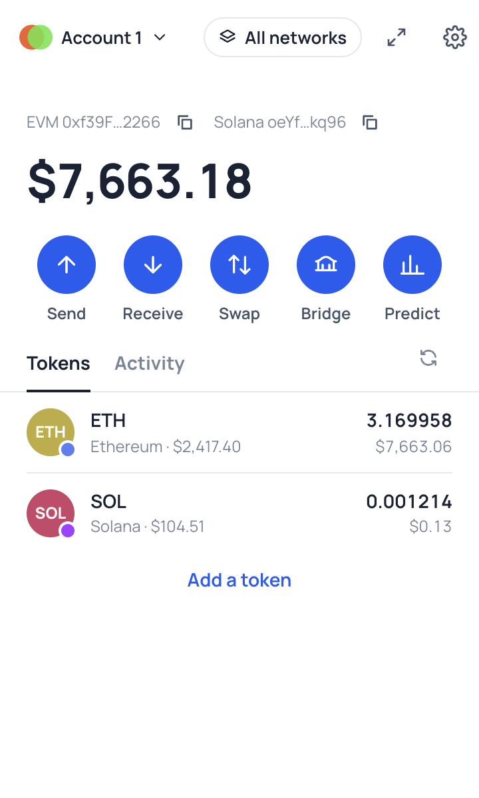
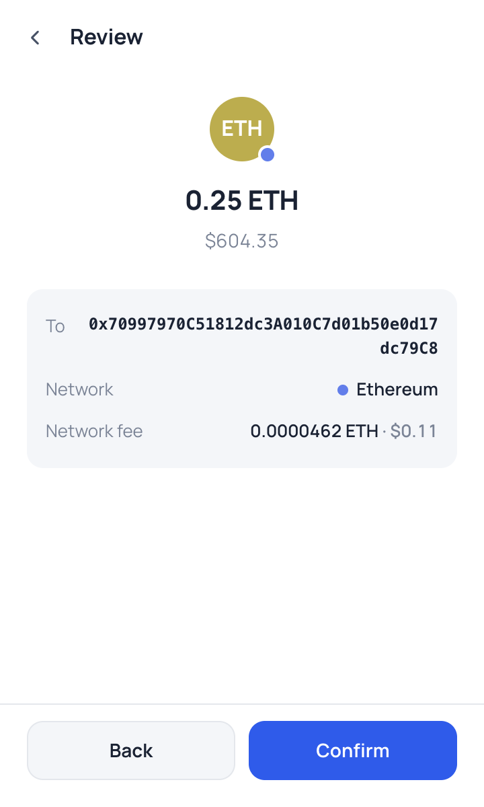
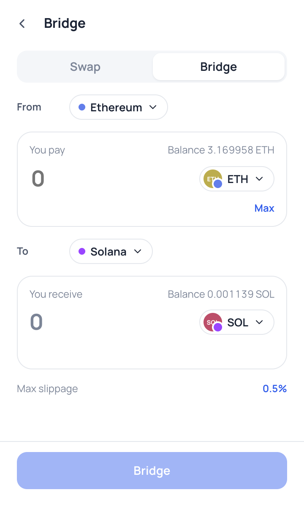
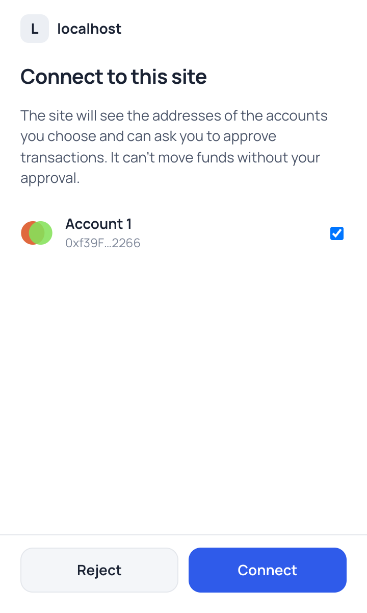

<div align="center">


# Duo Wallet

**A self-custodial Chrome extension wallet for Ethereum, EVM chains and Solana.**

One recovery phrase, one account list, both ecosystems: send, receive, swap and bridge, trade prediction markets, and connect to dApps on either chain.

</div>

<p align="center">
  
  
  
  
</p>

---

## Contents

- [Features](#features)
- [Quick start](#quick-start)
- [Development](#development)
- [Testing](#testing)
- [Project structure](#project-structure)
- [Configuration](#configuration)
- [Documentation](#documentation)
- [Known limitations](#known-limitations)

## Features

|                        |                                                                                                                                                                                                                                                                                                                             |
| ---------------------- | --------------------------------------------------------------------------------------------------------------------------------------------------------------------------------------------------------------------------------------------------------------------------------------------------------------------------- |
| **Accounts**           | Create or import 12/24-word recovery phrases, hold several phrases side by side, derive any number of accounts per phrase, or import a single EVM or Solana private key. Each phrase-derived account has an EVM and a Solana address, on the same paths MetaMask (`m/44'/60'/0'/0/i`) and Phantom (`m/44'/501'/i'/0'`) use. |
| **Portfolio**          | Native and token balances across all enabled networks, with USD prices. ERC-20 tokens are discovered through Blockscout; SPL and Token-2022 balances are read directly from Solana RPC. Custom tokens can be added by address.                                                                                              |
| **Send and receive**   | Native coins, ERC-20 and SPL tokens. The review screen shows the exact amount, network fee and any account-creation rent. Includes Max, an address book, recent recipients and QR codes.                                                                                                                                    |
| **Swap**               | Same-chain swaps via [LI.FI](https://li.fi) (EVM and Solana) or [Jupiter](https://jup.ag) (Solana). ERC-20 approvals are handled automatically, for the exact amount only.                                                                                                                                                  |
| **Bridge**             | Cross-chain transfers via LI.FI, including EVM ↔ Solana, with live status tracking.                                                                                                                                                                                                                                         |
| **Prediction markets** | Browse, chart and trade Polymarket markets through [Kairos](https://docs.kairos.trade/wallets/overview): one-time gasless setup, pUSD funding, limit and fill-or-kill orders, positions and cancels. Every Kairos signing request is checked before signing. See [docs/PREDICTION_MARKETS.md](docs/PREDICTION_MARKETS.md).  |
| **History**            | Blockscout or any Etherscan-compatible API for EVM networks, RPC for Solana, merged with transactions sent from the wallet so pending ones show immediately.                                                                                                                                                                |
| **dApp connectivity**  | EIP-1193 provider with EIP-6963 discovery, and a Solana [Wallet Standard](https://github.com/wallet-standard/wallet-standard) wallet. Every connection, signature and transaction goes through an approval window. See the [dApp integration guide](docs/DAPP_INTEGRATION.md).                                              |
| **Security**           | Vault encrypted with AES-256-GCM (PBKDF2-SHA256, 600k iterations). Auto-lock, password-gated key export and per-chain site permissions. Unlimited token approvals are flagged on the approval screen. See [SECURITY.md](SECURITY.md).                                                                                       |
| **Configurable**       | Every RPC, explorer, history provider, price source and swap/bridge endpoint can be changed in the UI, and custom EVM networks and Solana clusters can be added. All defaults are public and keyless.                                                                                                                       |

## Quick start

**Requirements:** Node.js 20 or later (see `.nvmrc`), [pnpm](https://pnpm.io) 10, and Google Chrome or another Chromium browser.

```bash
git clone git@github.com:kairoslive/wallet.git
cd wallet
pnpm install
pnpm build
```

Then load the extension:

1. Open `chrome://extensions`.
2. Turn on **Developer mode** (top right).
3. Click **Load unpacked** and select the `dist/` folder.
4. The onboarding tab opens automatically. Create a wallet or import a recovery phrase.

Pin the extension from the puzzle-piece menu for one-click access.

> **Prebuilt extension:** every CI run on `main` uploads the built `dist/` as the `duo-wallet-extension` artifact (Actions tab → latest run → Artifacts). Unzip it and use **Load unpacked** as above.

## Development

```bash
pnpm dev          # rebuild on change (reload the extension in chrome://extensions afterwards)
pnpm typecheck    # TypeScript
pnpm lint         # ESLint
pnpm format       # Prettier
pnpm check        # typecheck + lint + format check + unit/integration tests
```

`pnpm build` bundles four entry points into `dist/`:

| Output                | Source           | Runs in                                                                    |
| --------------------- | ---------------- | -------------------------------------------------------------------------- |
| `background.js`       | `src/background` | MV3 service worker. Holds keys while unlocked, signs, and talks to chains. |
| `popup.html` + assets | `src/ui`         | Toolbar popup (360×600), full-tab view and approval windows.               |
| `content.js`          | `src/content`    | Isolated world. Relays page ↔ background messages.                         |
| `inpage.js`           | `src/inpage`     | Page main world. `window.ethereum`, EIP-6963 and Wallet Standard.          |

## Testing

| Command                               | Scope                                                                                                                                                                                                                                                                                                                                                           |
| ------------------------------------- | --------------------------------------------------------------------------------------------------------------------------------------------------------------------------------------------------------------------------------------------------------------------------------------------------------------------------------------------------------------- |
| `pnpm test:unit`                      | ~380 tests: derivation vectors (BIP-39/32/44, SLIP-0010), vault crypto, amount handling, history parsers, LI.FI/Jupiter clients, `WalletService`, and the dApp controller.                                                                                                                                                                                      |
| `pnpm test:integration`               | `WalletService` and the dApp controller against real local chains: [anvil](https://book.getfoundry.sh/anvil/) for EVM, and a JSON-RPC server backed by [LiteSVM](https://github.com/LiteSVM/litesvm) for Solana. Covers native, ERC-20 and SPL transfers (including creating the recipient's token account), approve-then-swap, signing, and dApp transactions. |
| `pnpm test:e2e`                       | Builds the extension and drives it in Chromium with Playwright: onboarding, lock/unlock, network editing, sending ETH on anvil, receive, contacts, and connecting and signing from a test dApp.                                                                                                                                                                 |
| `pnpm test`                           | Unit and integration.                                                                                                                                                                                                                                                                                                                                           |
| `KAIROS_LIVE=1 pnpm test:integration` | Opt-in live checks against Kairos staging (prediction markets).                                                                                                                                                                                                                                                                                                 |

Apart from the opt-in Kairos staging checks, the test suites never use the public internet: anvil ships as an npm package and LiteSVM runs in-process. For e2e, install Chromium once with `pnpm exec playwright install chromium`.

`pnpm screenshots` regenerates the images in `docs/screenshots`.

## Project structure

```
src/
├── core/                 Chrome-agnostic wallet logic (tested in Node)
│   ├── crypto/           vault encryption, SLIP-0010
│   ├── keyring/          mnemonics, key derivation, private-key import formats
│   ├── evm/  solana/     chain clients (viem, @solana/web3.js)
│   ├── history/          Blockscout / Etherscan / Solana parsers, merged with local records
│   ├── swap/             LI.FI (swaps + bridges) and Jupiter clients
│   ├── predictions/      Kairos prediction markets: API clients and signing validator
│   ├── dapp/             DappController: EIP-1193 and Wallet Standard request handling
│   └── wallet/           WalletService: accounts, vault, settings, balances, send, swap, history
├── background/           service worker: message router, approval windows, auto-lock
├── content/              isolated-world relay
├── inpage/               injected providers
├── shared/               types shared by background and UI
└── ui/                   React popup: pages/, components/, lib/
tests/
├── unit/                 Vitest, Node
├── integration/          Vitest against anvil + LiteSVM
├── e2e/                  Playwright against the built extension
└── helpers/              anvil launcher, Solana RPC shim, test contracts
```

The architecture is described in [docs/ARCHITECTURE.md](docs/ARCHITECTURE.md).

## Configuration

Everything is configured from the UI and stored locally in the extension; there are no environment variables or build-time keys.

- **Settings → Networks:** RPC URL (with a connection test), chain id, explorer, history provider (Blockscout or Etherscan-compatible, with optional API key), price ids, and LI.FI chain id. You can enable or disable each network and add custom EVM networks and Solana clusters.
- **Settings → Swap & data providers:** LI.FI URL, API key and integrator; Jupiter URL and API key; the Solana swap provider; and the DefiLlama prices URL.
- **Settings:** auto-lock timeout, default slippage, testnet visibility, and zero-balance filtering.

Default networks and endpoints are listed in [docs/CONFIGURATION.md](docs/CONFIGURATION.md).

## Documentation

| Document                                                 | Contents                                                                               |
| -------------------------------------------------------- | -------------------------------------------------------------------------------------- |
| [docs/ARCHITECTURE.md](docs/ARCHITECTURE.md)             | Components, message flow, key handling, and storage layout.                            |
| [docs/DAPP_INTEGRATION.md](docs/DAPP_INTEGRATION.md)     | How dApps detect and talk to the wallet: supported methods, events, error codes.       |
| [docs/PREDICTION_MARKETS.md](docs/PREDICTION_MARKETS.md) | Kairos prediction markets: user flow, signature validation, endpoints, staging config. |
| [docs/CONFIGURATION.md](docs/CONFIGURATION.md)           | Default networks, RPCs, indexers and API endpoints.                                    |
| [SECURITY.md](SECURITY.md)                               | Security model and how to report issues.                                               |

## Known limitations

- **BNB Chain history:** there is no keyless history API, so history covers only transactions sent from the wallet. Adding an Etherscan v2 API key in the network's settings fixes this.
- **Blockscout bot checks:** some Blockscout instances show a bot check to certain IP ranges. The wallet reports this clearly, and the same setting can switch the network to Etherscan.
- **Testnets and custom networks:** LI.FI and Jupiter only route mainnets, so swaps and bridges are unavailable on testnets and custom networks.
- **Not yet supported:** hardware wallets, NFTs, and speeding up or cancelling a pending transaction.
