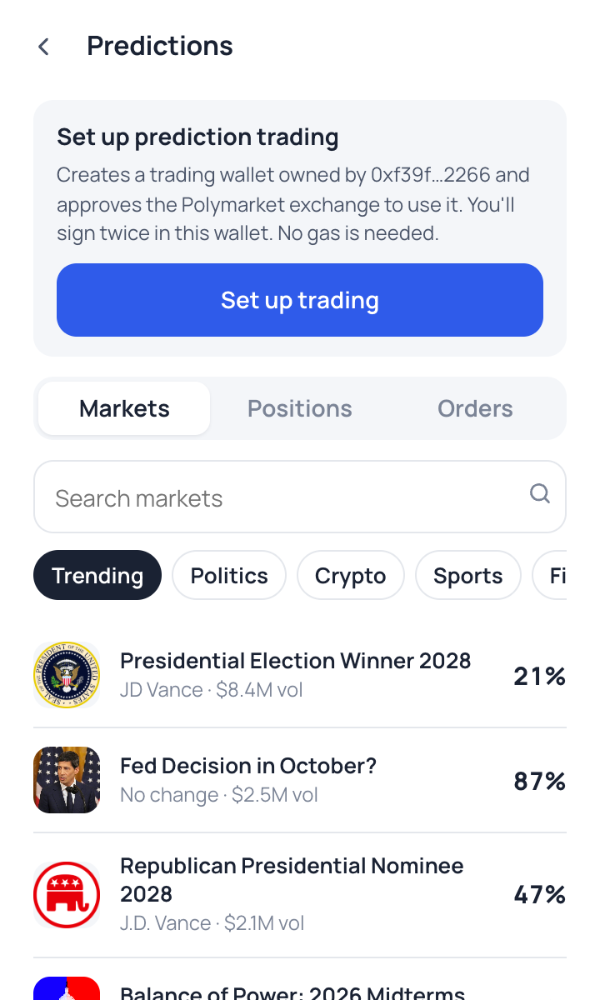
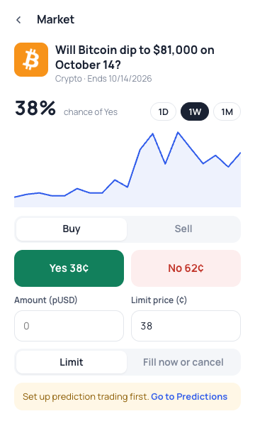

# Prediction markets

Duo Wallet lets users browse and trade [Polymarket](https://polymarket.com) prediction markets through the [Kairos wallet API](https://docs.kairos.trade/wallets/overview). Users keep their keys: Kairos builds each request, the wallet checks and signs it, and Kairos routes it to the venue. There is no Kairos account, API key or login per user.

  
  

## User flow

1. **Browse:** **Predict** on the home screen opens trending markets, with category filters and search. Grouped events (price ladders, multi-candidate races) open to their outcome list. A market shows its chance, a price chart (1H and 6H from 1-minute candles, refreshed every minute; 1D, 1W and 1M), and Yes/No prices.
2. **Set up (once per account):** the user signs twice in the wallet: a proof of wallet ownership, and a batch that approves the Polymarket exchange contracts to use their new **trading wallet** (a smart wallet owned by their address). No gas.
3. **Fund** from **Add funds**, powered by [Halliday](https://docs.halliday.xyz):
   - **From your wallet:** pick any held token on any supported chain (EVM networks or Solana) and see a live quote. The token goes to a one-time Halliday deposit address, and pUSD is delivered to the trading wallet. pUSD on Polygon is sent directly. Sending needs a little gas on the source chain.
   - **Card or bank:** compare onramp quotes (Coinbase, Stripe, MoonPay, Transak) and finish checkout in a new tab. pUSD arrives in the trading wallet when the payment clears.

   Before any funds move, the wallet checks Halliday's deposit instruction against the quote: same token, same chain, no more than the amount entered. Halliday's one-time owner verification (payments of $300 or more) is signed only if it isn't a token permission.

4. **Trade:** buy or sell Yes/No shares.
   - **Market orders (default):** enter an amount. The wallet walks the live order book to show shares, average price and worst price, then sends a fill-and-kill order capped at that worst price (at most 5¢ from the best price). Warnings appear for a wide spread (5¢ or more), a thin book (under $250 within 5¢ of the best price), an order that moves the price (1¢+ or 5%+), high slippage (3¢+ or 15%+), and an order too large to fill within the 5¢ band. The last two are repeated on the confirm screen.
   - **Limit orders:** chosen from the **Order type** dropdown, with a limit price and a time in force (until cancelled, or fill now or cancel).

   One signature, no gas.

5. **Order book:** the book icon (or **Order book** next to the order type) opens a live book per outcome, with asks over bids, depth bars and the spread. It streams from the Kairos market-data WebSocket's `orderbook_slow` topic on the anonymous public tier: grouped deltas about every 150 ms, applied with the documented sequence, baseline and epoch rules, and re-fetching a snapshot on any gap.
6. **Manage:** the **Positions** and **Orders** tabs list holdings and orders; open orders can be cancelled individually or all at once (one signature each). These reads are private: the first one runs a `login` action, which the wallet signs (one Sign-In with Ethereum message) and swaps for a read-only token valid 24 hours, sent as `Authorization: SIWE <token>`. The token is reused until it expires or the wallet locks, and a rejected token triggers one fresh sign-in. A wallet that isn't set up shows empty lists without signing in.

## Recovering tokens sent by mistake

Only **pUSD** counts as trading balance. If another token (USDC, USDC.e, USDT) is sent to the trading wallet, the **Predictions** screen shows a recovery card. Converting inside the trading wallet needs the venue's relayer, so the wallet uses the deposit wallet's built-in owner exit instead:

1. **Start recovery:** the owner pauses the trading wallet (`pause()`).
2. **Wait:** the factory's timelock is currently 1 hour, measured in block time.
3. **Withdraw to my wallet:** `withdrawERC20` for each stray token back to the owner, then `unpause()` so trading continues normally.
4. **Convert to pUSD and add funds:** opens **Add funds** with the recovered token preselected and converts it into the trading wallet in one step.

Each step is a Polygon transaction from the owner, which only the owner can send, so the owner account pays a few cents of POL in gas. If it has too little, the card shows the exact amount needed with the address and a QR code (or **Bridge POL from another network**), watches the balance, and continues automatically once the POL arrives. The deposit sheet warns that only pUSD on Polygon should be sent.

## Signature validation

Kairos sends each step as an `eth_signTypedData_v4` request (or `personal_sign` for the sign-in). Before signing, the wallet checks every request against the action the user started (`src/core/predictions/verify.ts`) and refuses anything else. It never falls back to signing blindly.

| Check                                   | Rule                                                                                                                                                                                                                                                                                                                                 |
| --------------------------------------- | ------------------------------------------------------------------------------------------------------------------------------------------------------------------------------------------------------------------------------------------------------------------------------------------------------------------------------------ |
| Method                                  | Only `eth_signTypedData_v4` (or `personal_sign` during a `login`), only for the user's own address.                                                                                                                                                                                                                                  |
| Chain                                   | EIP-712 domain `chainId` must be Polygon (137).                                                                                                                                                                                                                                                                                      |
| Ownership proof (`ClobAuth`)            | Only during setup, and only for the user's own address.                                                                                                                                                                                                                                                                              |
| Contract-call batches (`DepositWallet`) | Only during setup, and only for the user's trading wallet. Every call must be `approve` on pUSD or `setApprovalForAll` on the Conditional Tokens contract, with zero value, exact calldata length, and a spender from the known Polymarket/Kairos exchange contracts. Transfers, unknown contracts and unknown spenders are refused. |
| Sign-in (`login`)                       | Must be a Sign-In with Ethereum (EIP-4361, version 1) message for the user's address with a nonce, whose domain and URI are the configured wallet API host or a `kairos.trade` host. Sign-ins for other sites are refused.                                                                                                           |
| Orders                                  | Maker/signer must be the user or their trading wallet, the token id must be the outcome the user chose, the side must match, and the amount given up can't exceed what the user confirmed (1% rounding tolerance).                                                                                                                   |

If Kairos rotates its exchange contracts, setup will refuse the new spender until the allowlist in `verify.ts` (`TRUSTED_SPENDERS`) is updated.

## Configuration

Edit it under **Settings → Swap & data providers → Prediction markets (Kairos)**. Defaults point at **staging** for the pilot:

| Setting          | Staging (default)                                                     | Production                  |
| ---------------- | --------------------------------------------------------------------- | --------------------------- |
| Partner id       | `wallet-pilot`                                                        | Assigned by Kairos          |
| Wallet API URL   | `https://staging-execution.kairos.trade`                              | Assigned by Kairos          |
| Data API URL     | `https://staging-data.kairos.trade`                                   | `https://data.kairos.trade` |
| Market data URL  | `https://staging-md.kairos.trade`                                     | `https://md.kairos.trade`   |
| Orderbook stream | `wss://stream.kairos.trade` (staging's stream currently has no books) | `wss://stream.kairos.trade` |

| Halliday API URL | `https://v2.prod.halliday.xyz` | same |
| Halliday key | publishable `pk_…` key | publishable `pk_…` key |

The partner id is sent as `X-Kairos-Partner-Id` on every wallet API request. The feature can be turned off with the same settings toggle, which hides **Predict** from the home screen.

## APIs used

| Purpose                                       | Endpoint                                                    |
| --------------------------------------------- | ----------------------------------------------------------- |
| Market list, categories, search               | `GET {data}/api/markets/discover/v2` (public)               |
| Market detail and outcome tokens              | `GET {md}/v1/markets/polymarket/{market_id}`                |
| Prices                                        | `GET {md}/v1/marks`                                         |
| Chart                                         | `GET {md}/v1/candles`                                       |
| Trading status (`next`: setup / fund / ready) | `GET {exec}/v3/wallets/{address}`                           |
| Login, setup, order, cancel                   | `POST {exec}/v3/actions`, `POST/GET {exec}/v3/actions/{id}` |
| Orders, positions (`Authorization: SIWE …`)   | `GET {exec}/v3/wallets/{address}/orders`, `/positions`      |

## Current limitations

- **Orders on staging:** staging accepts setup but rejects orders with `trading is not available on this node`. The order flow is implemented and unit-tested to the documented API, and that message is shown as-is.
- **Sign-in not deployed yet:** SDK 0.2.0 and the docs require a `login` action before reading orders and positions, but staging and production both still reject `login` (`unknown variant`). Until they ship it, the Positions and Orders tabs say the node doesn't support signing in yet. Trading is unaffected.
- **Withdrawals:** the wallet API has no withdrawal action. Funds in the trading wallet can't be moved back from Duo yet.
- **Venues:** only Polymarket (pUSD on Polygon).
- **Order responses:** order and position records are loosely typed in the API, so the lists read common field names defensively.

## Tests

- `tests/unit/predictions.test.ts`:
  - the validator, using real staging payloads plus attack cases (transfer calls, unknown contracts or spenders, wrong wallet or chain, mismatched orders);
  - the Kairos client (mapping, polling, partner header);
  - the service flow, including proof that a malicious batch is never signed or submitted.
- `tests/integration/kairos-staging.test.ts`: live against staging, opt-in with `KAIROS_LIVE=1 pnpm test:integration`. Lists and loads markets, then runs a full setup for a fresh wallet through the validator.
- `tests/unit/halliday.test.ts` and `tests/integration/halliday-deposit.test.ts`: Halliday asset mapping and quote handling; real token deposits on anvil with Halliday mocked. Tampered deposit instructions and permit-style "verifications" are refused before any funds move.
- `tests/unit/orderbook.test.ts`: the protobuf codec, book sequencing (gaps, stale deltas, epoch fencing, baseline mismatch), and market-order book walks. `tests/integration/kairos-stream.test.ts` checks the live feed (opt-in).
- `tests/integration/recovery-fork.test.ts`: the full recovery against the real Polymarket deposit-wallet contract on a Polygon mainnet fork. Opt-in with `RECOVERY_FORK=1 pnpm test:integration`.
- `tests/e2e/predictions.spec.ts`: live UI flow in the built extension (browse, search, market, setup, funding sheet), opt-in with `KAIROS_LIVE=1 pnpm test:e2e`.
